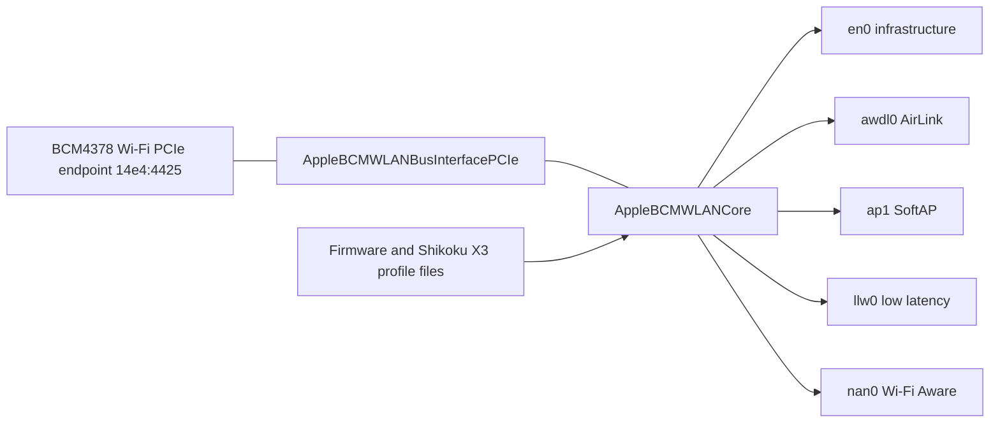

# DriverKit and radio services

## Shipped host driver

The running driver process points to `/System/Library/DriverExtensions/com.apple.DriverKit-AppleBCMWLAN.dext/com.apple.DriverKit-AppleBCMWLAN`. The installed executable is 10,564,944 bytes with `arm64e` and `arm64e.x1` slices. REA inspected the `arm64e` slice. Its declared dependencies include BroadcomWLANDriverKit, IO80211DriverKit, OLYHALDriverKit, PCIDriverKit and IOFileValidation. The bundle identifies DriverKit 27.2, and signature display reports Apple's macOS software signing chain. A separate BCM4378 Hashstore kernel bundle is present. [DriverKit binary evidence](../evidence/2026-11-17-driverkit.json)

## Running Wi-Fi interfaces

| BSD interface | Role published by the driver | Status and supported access |
| --- | --- | --- |
| `en0` | Infrastructure | Active. The default route and only CoreWLAN-visible Wi-Fi object in the sample. CoreWLAN reports station mode. [Status snapshot](../evidence/2026-11-17-corewlan-status.json) |
| `awdl0` | AirLink | Active flag and link status. Apple supports peer-to-peer opt-in in Network framework. A particular peer session was outside this sample. [Apple peer-to-peer networking](https://developer.apple.com/documentation/technotes/tn3151-choosing-the-right-networking-api#Peer-to-peer-networking) |
| `ap1` | SoftAP | Registered but link status was inactive. macOS documents Ethernet-to-Wi-Fi Internet Sharing. Same-chip uplink plus SoftAP remains unverified. [Apple Internet Sharing](https://support.apple.com/en-euro/guide/mac-help/mchlp1540/27/mac/27) |
| `llw0` | LowLatency | Up and running flags. Network framework exposes a traffic service class. The reviewed public documentation gives no application binding to this specific driver role. [Network service class](https://developer.apple.com/documentation/network/nwparameters/serviceclass-swift.property) |
| `nan0` | Wi-Fi Aware Discovery+Data | Registered with neither the up nor running flag. The installed native macOS SDK rejects `WACapabilities` at type-check time. [Apple Developer Technical Support](https://developer.apple.com/forums/thread/827887) |

The mapping uses the driver-published interface-name prefix and unit. State flags and link status come from `ifconfig` and are snapshots. [I/O Registry and interface snapshot](../evidence/2026-11-17-macos-inventory.json)

### Passive interface activity

All five roles returned link-layer counters in 46 snapshots over 45 seconds. The `en0` byte and packet counters increased in all 45 intervals. The other four stayed flat. `awdl0` started with nonzero counters from earlier host activity. The IPv4 default interface was `en0` before and after the window. [Passive counter evidence](../evidence/2026-11-17-peer-interface-activity.json), [Apple netstat source](https://github.com/apple-oss-distributions/network_cmds/blob/main/netstat.tproj/if.c)

The role-counter tool reports byte and packet deltas and counts intervals with activity on both `en0` and a secondary interface. A positive overlap would establish host activity inside that interval. An owned peer and synchronized radio observations would still be needed to attribute a transfer and identify the exact airtime or channel combination. [Counter tool](../tools/read_link_role_counters.py)

## Bluetooth endpoint

Both macOS I/O Registry planes place the Wi-Fi and Bluetooth PCI functions under the same bridge. The J313 Linux device tree independently places the two functions at `01:00.0` and `01:00.1` below `pcie0/port00`. Linux enumerates the internal Broadcom cores from the radio's ROM. The shared host port establishes the board-level attachment and leaves the on-chip D11 count open. [Filtered local topology](../evidence/2026-11-17-pcie-function-topology.json), [J313 device tree](https://github.com/torvalds/linux/blob/v6.12/arch/arm64/boot/dts/apple/t8103-j313.dts#L32-L37), [M1 PCIe functions](https://github.com/torvalds/linux/blob/v6.12/arch/arm64/boot/dts/apple/t8103-jxxx.dtsi#L64-L83), [Linux core discovery](https://github.com/torvalds/linux/blob/v6.12/drivers/net/wireless/broadcom/brcm80211/brcmfmac/chip.c#L849-L893)

The host lists the Broadcom Bluetooth PCIe endpoint as `14e4:5f69` with an `AppleConvergedPCI` child. System Information reports chipset `BCM_4378`, transport PCIe and controller firmware `24.2.551.4122`. Its service flags include HFP, AVRCP, A2DP, HID, LEA, AACP, GATT, SerialPort and SCO. The service flags describe the host's reported services. A negotiated service or PHY would require separate runtime evidence. [Host inventory](../evidence/2026-11-17-macos-inventory.json), [Linux Bluetooth identifier](https://github.com/torvalds/linux/blob/v6.12/drivers/bluetooth/hci_bcm4377.c)

The version uniquely matches the embedded release in the installed Shikoku MUR firmware. The companion report records the format, PTB matches, observed PCIe aperture lengths and macOS API availability. [Bluetooth firmware investigation](bluetooth-firmware.md)
